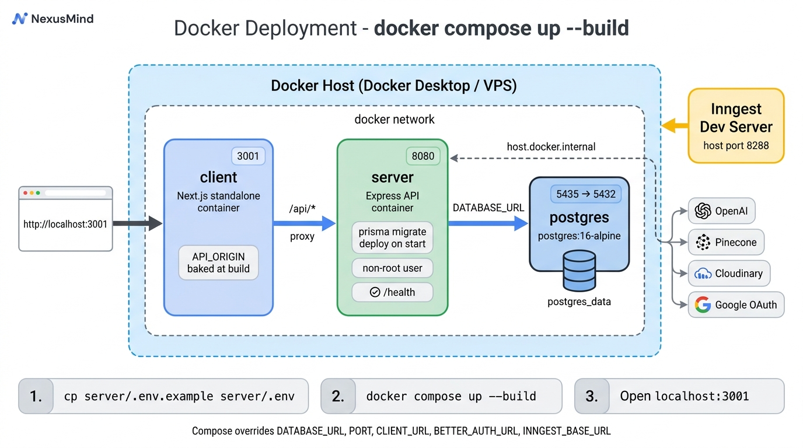

# Deployment Guide

NexusMind can be deployed in two ways:

1. **Docker (self-hosting):** run the full stack (PostgreSQL, API, and web client) on your own machine or a VPS with Docker Compose.
2. **Vercel (cloud):** deploy the web client and the API as two Vercel projects, with a hosted PostgreSQL database and Inngest Cloud for background jobs.

---

## Docker (Self-Hosting)



### Prerequisites

- Docker Desktop, or Docker Engine with the Compose plugin
- API keys for OpenAI, Pinecone and Cloudinary
- A Google OAuth client ID and secret
- [Inngest Dev Server](#running-inngest-locally-job-queue) running on your host (Node.js 22+)

### Quick start

```bash
# 1. Create the server environment file and fill in your keys
cp server/.env.example server/.env

# 2. Build and start PostgreSQL, the API and the web client
docker compose up --build
```

The first build takes several minutes because it downloads dependencies and compiles both images. Later builds are much faster thanks to Docker's layer cache.

| Service | URL |
| --- | --- |
| Web client | http://localhost:3001 |
| API | http://localhost:8080 (health: `/health`) |
| PostgreSQL | `localhost:5435` |

The API container runs `prisma migrate deploy` on startup, so the database schema is applied automatically.

### Environment variables for Docker

Compose overrides some values for the containers (`DATABASE_URL`, `PORT`, `CLIENT_URL`, `BETTER_AUTH_URL`, `INNGEST_BASE_URL`). You only need to set the rest in `server/.env`.

| Variable | Required | Notes |
| --- | --- | --- |
| `BETTER_AUTH_SECRET` | ✅ | Long random string (for example, output of `openssl rand -base64 32`) |
| `GOOGLE_CLIENT_ID` | ✅ | Google OAuth client ID |
| `GOOGLE_CLIENT_SECRET` | ✅ | Google OAuth client secret |
| `OPENAI_API_KEY` | ✅ | Chat, embeddings and moderation |
| `PINECONE_API_KEY` | ✅ | Vector store |
| `PINECONE_INDEX` | ✅ | Index with 1536 dimensions and cosine metric |
| `CLOUDINARY_CLOUD_NAME` | ✅ | PDF storage |
| `CLOUDINARY_API_KEY` | ✅ | PDF storage |
| `CLOUDINARY_API_SECRET` | ✅ | PDF storage |
| `CLOUDINARY_FOLDER` | ➖ | Defaults to `nexusmind/pdfs` |
| `FIRECRAWL_API_KEY` | ➖ | Website import |
| `TAVILY_API_KEY` | ➖ | Web search in chat |
| `MEM0_API_KEY` | ➖ | Long-term memory |
| `TOKEN_QUOTA_PER_USER` | ➖ | Lifetime token budget per user (default 50,000) |

The client needs no runtime variables. Its `API_ORIGIN` is set at build time by `docker-compose.yml`.

### Running Inngest locally (job queue)

The Compose file does not include an Inngest container. Source processing and artifact generation need the Inngest Dev Server running on your host, on port `8288`:

```bash
npx inngest-cli@latest dev -u http://localhost:8080/api/inngest
```

Leave it running while the stack is up. Without it, newly added sources stay in `PENDING`.

### Useful Docker commands

```bash
docker compose up -d --build        # start in the background
docker compose logs -f server       # follow API logs
docker compose ps                   # check health status
docker compose down                 # stop containers (keeps database data)
docker compose down -v              # stop and delete database data
docker compose build --no-cache     # full rebuild after dependency changes
```

### Google OAuth for Docker / VPS

1. In [Google Cloud Console](https://console.cloud.google.com/), open **APIs & Services → Credentials** and edit your OAuth client.
2. Add `http://localhost:8080` to **Authorized JavaScript origins**.
3. Add `http://localhost:8080/api/auth/callback/google` to **Authorized redirect URIs**.
4. For a VPS, replace `localhost` with your public domain in both fields and in the `BETTER_AUTH_URL` and `CLIENT_URL` values in `docker-compose.yml`.
5. Rebuild the stack: `docker compose up -d --build`.

---

## Vercel Deployment

The project is deployed as two Vercel projects from the same repository.

| Project | Root Directory | What it is |
| --- | --- | --- |
| **API** | `server` | Express serverless function (`api/index.ts`) |
| **Web** | `client` | Next.js frontend |

### Step 1: Push to GitHub

```bash
git push origin main
```

### Step 2: Create the Vercel projects

Import the repository twice in Vercel. Use these settings:

- **API project:** Root Directory `server`, Framework Preset *Other*.
- **Web project:** Root Directory `client`, Framework Preset *Next.js*.

### Step 3: Deploy the API first

Deploy the API project before the web project, because the web project needs the API URL. Note the deployment URL, for example `https://nexusmindapi.sanjaysorathiya.dev`.

### Step 4: Set environment variables for the API project

Add these in **Settings → Environment Variables** for the API project:

| Variable | Value |
| --- | --- |
| `DATABASE_URL` | Your PostgreSQL connection string |
| `BETTER_AUTH_SECRET` | Long random string |
| `BETTER_AUTH_URL` | Your API URL, for example `https://nexusmindapi.sanjaysorathiya.dev` |
| `CLIENT_URL` | Your web URL, for example `https://nexusmind.sanjaysorathiya.dev` |
| `GOOGLE_CLIENT_ID` | Google OAuth client ID |
| `GOOGLE_CLIENT_SECRET` | Google OAuth client secret |
| `OPENAI_API_KEY` | OpenAI key |
| `PINECONE_API_KEY` | Pinecone key |
| `PINECONE_INDEX` | Pinecone index name |
| `CLOUDINARY_CLOUD_NAME`, `CLOUDINARY_API_KEY`, `CLOUDINARY_API_SECRET` | Cloudinary credentials |
| `INNGEST_EVENT_KEY` | From the Inngest Cloud dashboard |
| `INNGEST_SIGNING_KEY` | From the Inngest Cloud dashboard |
| `INNGEST_SERVE_ORIGIN` | Your API URL |

> **Database note:** use a connection string that works from serverless functions, such as a pooled connection from your PostgreSQL provider. Do not set `INNGEST_DEV` in production.

Optional keys (`FIRECRAWL_API_KEY`, `TAVILY_API_KEY`, `MEM0_API_KEY`, `TOKEN_QUOTA_PER_USER`) can be added the same way.

### Step 5: Run database migrations

Run this from your machine against the production database:

```bash
cd server
DATABASE_URL="postgresql://..." npx prisma migrate deploy
```

### Step 6: Connect Inngest

1. Create an app in [Inngest Cloud](https://app.inngest.com/) and copy its event and signing keys into the API project (Step 4).
2. In Inngest, sync the app with `https://nexusmindapi.sanjaysorathiya.dev/api/inngest`.
3. Confirm that the functions `process-source`, `summarize-conversation`, `generate-artifact` and `reap-stale-sources` appear.

### Step 7: Deploy the web project and set its variables

Add this variable to the web project, then deploy:

| Variable | Value |
| --- | --- |
| `API_ORIGIN` | Your API URL, for example `https://nexusmindapi.sanjaysorathiya.dev` |
| `NEXT_PUBLIC_WEB3FORMS_KEY` | Optional, for the feedback form |

> Do not set `NEXT_PUBLIC_API_URL` in production. The browser calls `/api/*` on the web domain, and Next.js forwards those requests to `API_ORIGIN`.

### Step 8: Update Google OAuth

In Google Cloud Console, add your production values:

- **Authorized JavaScript origins:** your web URL (for example `https://nexusmind.sanjaysorathiya.dev`)
- **Authorized redirect URIs:** `https://nexusmindapi.sanjaysorathiya.dev/api/auth/callback/google`

### Step 9: (Optional) Add a custom domain

1. In the web project, go to **Settings → Domains** and add your domain (for example `nexusmind.sanjaysorathiya.dev`).
2. Add the DNS record Vercel shows you at your DNS provider.
3. Update `CLIENT_URL` in the API project, and the Google OAuth origins, to the new domain. Redeploy the API.

---

## Environment Variables: Quick Reference

### `server/.env` (Docker) and the API project (Vercel)

| Variable | Required | Purpose |
| --- | --- | --- |
| `DATABASE_URL` | ✅ | PostgreSQL connection |
| `BETTER_AUTH_SECRET` | ✅ | Session signing |
| `BETTER_AUTH_URL` | ✅ | Public API URL |
| `CLIENT_URL` | ✅ | Web origin (CORS, trusted origins) |
| `GOOGLE_CLIENT_ID` | ✅ | Google sign-in |
| `GOOGLE_CLIENT_SECRET` | ✅ | Google sign-in |
| `OPENAI_API_KEY` | ✅ | LLM, embeddings, moderation |
| `PINECONE_API_KEY` | ✅ | Vector store |
| `PINECONE_INDEX` | ✅ | Vector index name |
| `CLOUDINARY_CLOUD_NAME` | ✅ | PDF storage |
| `CLOUDINARY_API_KEY` | ✅ | PDF storage |
| `CLOUDINARY_API_SECRET` | ✅ | PDF storage |
| `CLOUDINARY_FOLDER` | ➖ | PDF folder |
| `FIRECRAWL_API_KEY` | ➖ | Website import |
| `TAVILY_API_KEY` | ➖ | Web search |
| `MEM0_API_KEY` | ➖ | Memory |
| `TOKEN_QUOTA_PER_USER` | ➖ | Token budget per user |
| `INNGEST_EVENT_KEY` | Vercel | Inngest Cloud |
| `INNGEST_SIGNING_KEY` | Vercel | Inngest Cloud |
| `INNGEST_SERVE_ORIGIN` | Vercel | Public API origin for Inngest |

### `client/.env.local` (local) and the web project (Vercel)

| Variable | Required | Purpose |
| --- | --- | --- |
| `API_ORIGIN` | Vercel | Server-side `/api` proxy target |
| `NEXT_PUBLIC_API_URL` | Local only | Direct API URL in development |
| `NEXT_PUBLIC_WEB3FORMS_KEY` | ➖ | Feedback form |

---

## Post-Deploy Checklist

- [ ] `https://nexusmindapi.sanjaysorathiya.dev/health` returns OK
- [ ] The web app loads and the Google sign-in completes
- [ ] You can create a workspace
- [ ] Uploading a PDF or importing a website moves the source to `READY`
- [ ] A chat answer streams and shows citations
- [ ] An artifact (for example Summary) generates successfully
- [ ] Inngest shows the four functions as synced
- [ ] Database migrations are applied (`prisma migrate status`)
- [ ] Google OAuth origins and redirect URIs match the deployed domains
- [ ] (Docker) `docker compose ps` shows all services as healthy
