# NexusMind Studio

**A full-stack AI research workspace built on Retrieval-Augmented Generation (RAG).**
Bring your own sources (PDFs, websites, YouTube videos, text and Markdown) and chat with them. Answers are grounded in your sources and include citations, and you can generate study artifacts from the same material.

[](https://nexusmind.sanjaysorathiya.dev)
[](https://nexusmindapi.sanjaysorathiya.dev/health)


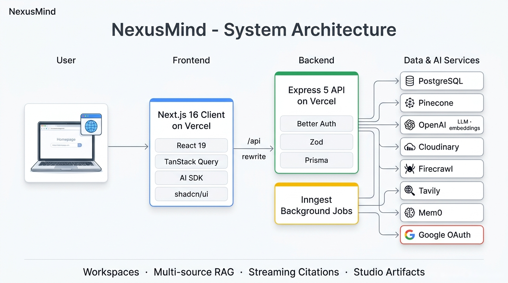

---

## Table of Contents

1. [Overview](#1-overview)
2. [Key Features](#2-key-features)
3. [Screenshots](#3-screenshots)
4. [Tech Stack](#4-tech-stack)
5. [System Architecture](#5-system-architecture)
6. [Core Flows](#6-core-flows)
7. [Repository Structure](#7-repository-structure)
8. [Getting Started](#8-getting-started)
9. [Deployment](#9-deployment)
10. [Roadmap](#10-roadmap)
11. [Detailed Documentation](#11-detailed-documentation)

---

## 1. Overview

NexusMind groups knowledge into **workspaces**. Each workspace holds its own sources, conversations and generated artifacts.

- **Ingest:** Sources are extracted, chunked, embedded and indexed in the background by durable jobs.
- **Ask:** Questions are answered by streaming LLM responses grounded in the most relevant chunks, with inline citations.
- **Learn:** The same sources can be turned into summaries, flashcards, quizzes, mind maps and reports.

| Component | Location | Production URL |
| --- | --- | --- |
| Frontend (Next.js) | [`client/`](client/README.md) | https://nexusmind.sanjaysorathiya.dev |
| Backend API (Express) | [`server/`](server/README.md) | https://nexusmindapi.sanjaysorathiya.dev |

## 2. Key Features

| Area | Capability |
| --- | --- |
| **Workspaces** | Isolated, per-user knowledge spaces for sources, chats and artifacts |
| **Multi-source ingestion** | PDF upload, website URL import, YouTube links, Markdown and Text  |
| **Background processing** | Durable Inngest pipeline (extract → chunk → embed → index) with retries and a stale-job reaper |
| **Grounded RAG chat** | Streaming answers with source citations `[1]`, `[2]` and per-workspace vector search |
| **Web search (opt-in)** | Live web context through Tavily, cited separately as `[W1]`, `[W2]` |
| **Memory** | Long-term user memory (Mem0) plus rolling conversation summaries |
| **Studio artifacts** | Summary, Key Takeaways, Flashcards, Quiz, Mind Map and Report |
| **Safety & limits** | Input moderation and a per-user token quota |
| **Authentication** | Google sign-in through Better Auth, with per-user data isolation |

## 3. Screenshots

> System screenshots in `.Notes/screenshots/`.

| Landing | Workspaces |
| --- | --- |
| 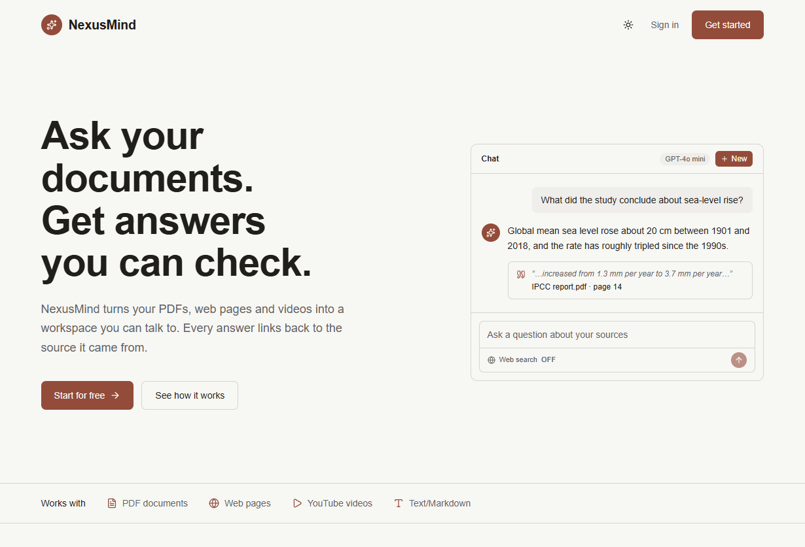 | 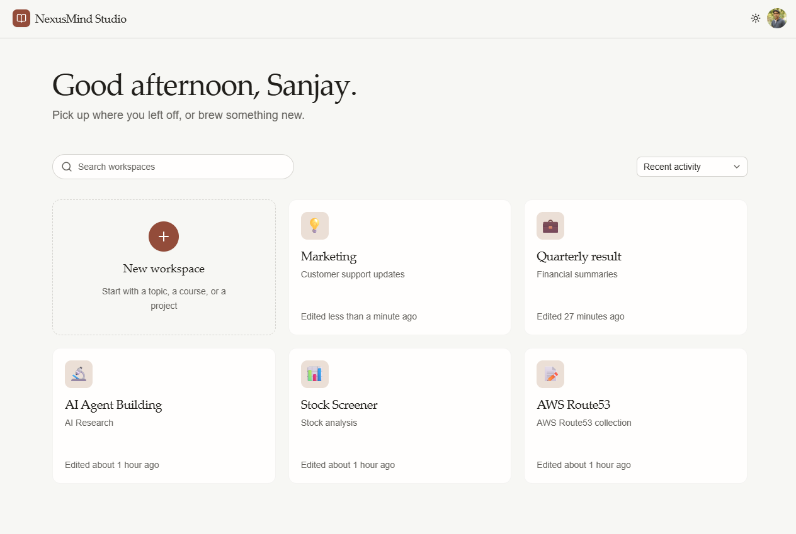 |
| **Workspace: Sources + Chat + Studio** | **Generated Artifact** |
| 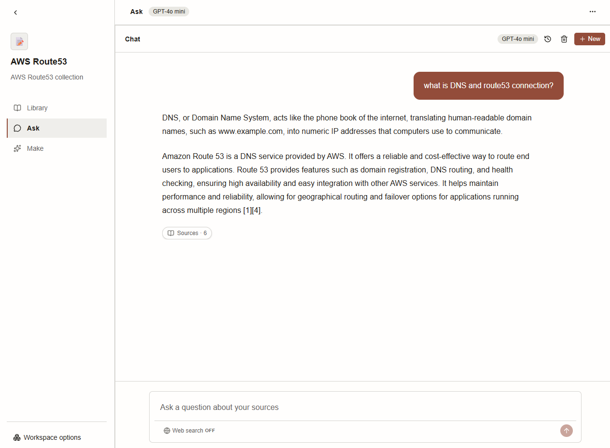 | 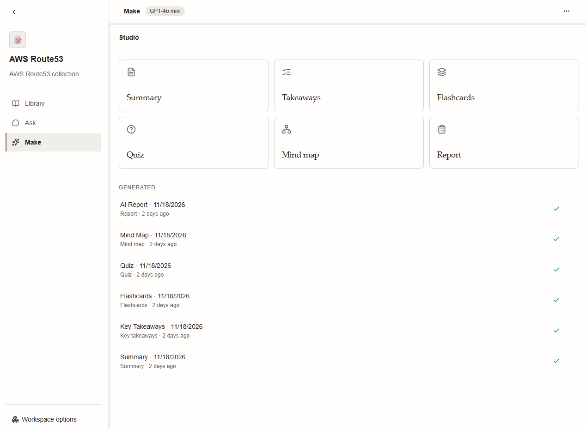 |

## 4. Tech Stack

| Layer | Technologies |
| --- | --- |
| Frontend | Next.js 16 (App Router), React 19, TypeScript, Tailwind CSS 4, shadcn/ui, TanStack Query, Vercel AI SDK |
| Backend | Node.js 22, Express 5, TypeScript, Zod, Multer |
| Database | PostgreSQL + Prisma 7 |
| Authentication | Better Auth (Google OAuth) |
| AI / LLM | OpenAI `gpt-4o-mini` / `gpt-4o`, `text-embedding-3-small` (1536-d) |
| Vector Store | Pinecone (one namespace per workspace) |
| Background Jobs | Inngest |
| Ingestion | unpdf, Cloudinary (PDF storage), Firecrawl (websites), youtube-transcript |
| Augmentation | Tavily (web search), Mem0 (memory) |
| Hosting | Vercel (frontend and backend as separate projects), Docker for local use |

## 5. System Architecture

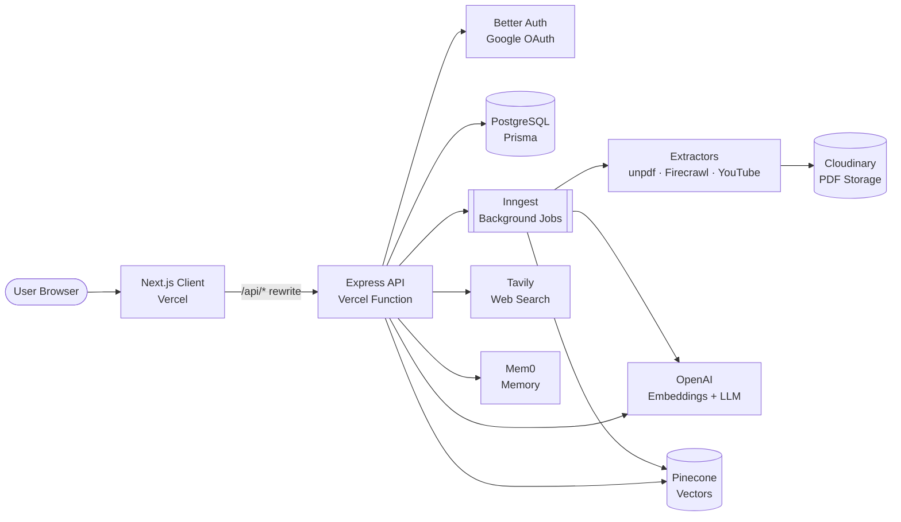

## 6. Core Flows

### 6.1 RAG Ingestion Pipeline
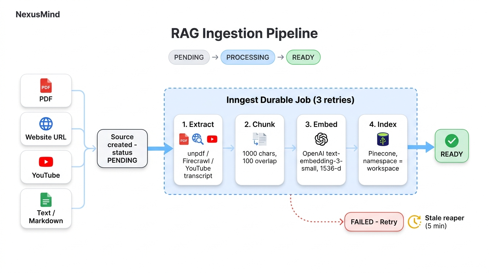

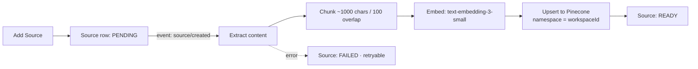

### 6.2 Query / Chat Flow
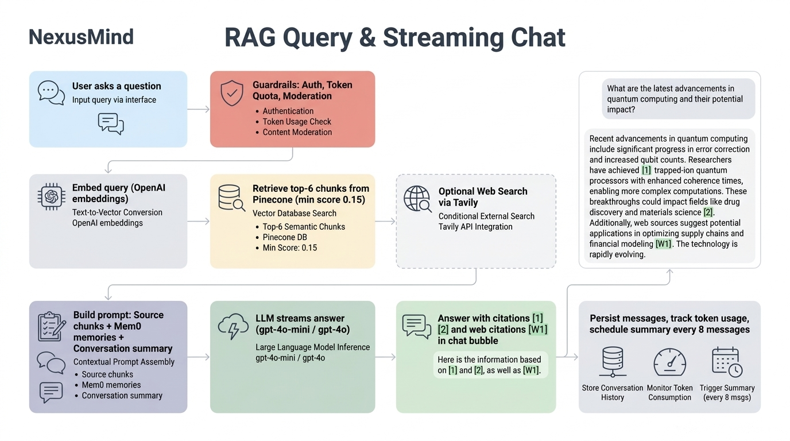

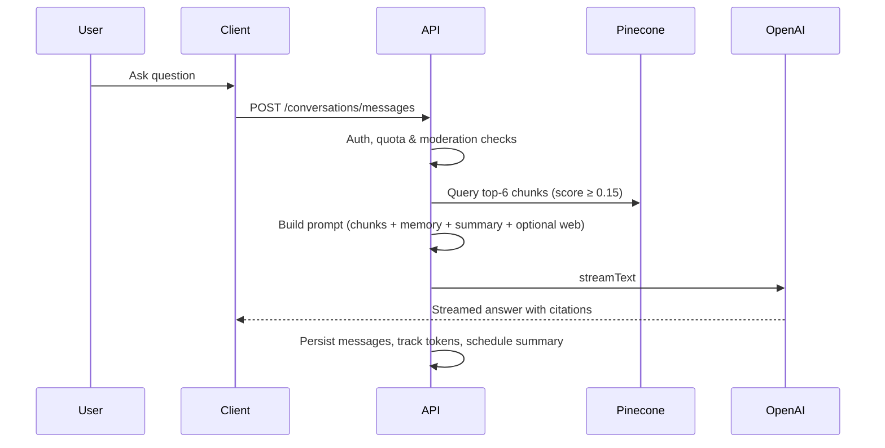

### 6.3 Workspace Flow
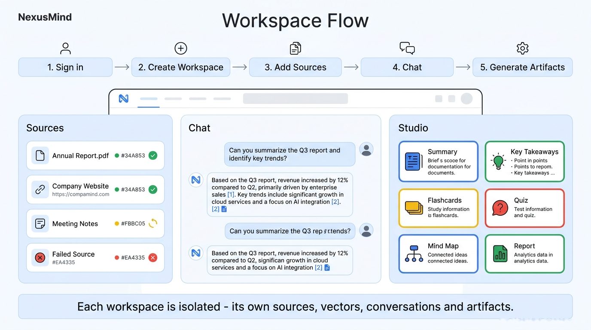

### 6.4 Authentication Flow
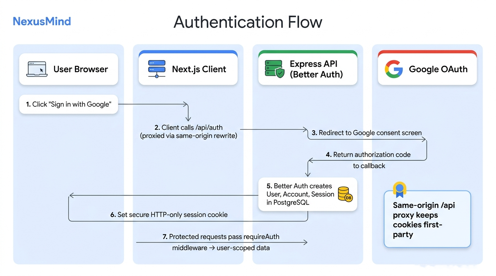

## 7. Repository Structure

```text
NexusMind/
├── client/                # Next.js frontend  → see client/README.md
├── server/                # Express API + Inngest jobs → see server/README.md
├── .Notes/                # README images, screenshots & image-generation prompts
│   └── prompts/
├── docker-compose.yml     # Local full-stack orchestration
├── DEPLOY.md              # Docker and Vercel deployment guide
└── README.md
```

## 8. Getting Started

**Prerequisites:** Node.js 22, PostgreSQL, and API keys for OpenAI, Pinecone, Cloudinary and Google OAuth. Firecrawl, Tavily and Mem0 keys are optional.

```bash
# 1. Clone
git clone https://github.com/SanjaySorathiya/NexusMind.git && cd NexusMind

# 2. Backend
cd server
cp .env.example .env          # fill in values
npm install
npx prisma migrate deploy
npm run dev                   # http://localhost:8080

# 3. Inngest dev server (new terminal)
npx inngest-cli@latest dev -u http://localhost:8080/api/inngest

# 4. Frontend (new terminal)
cd client
cp .env.example .env.local
npm install
npm run dev                   # http://localhost:3001
```

To run the full stack in Docker instead (PostgreSQL, API and web client), see the [Docker quick start in DEPLOY.md](DEPLOY.md#docker-self-hosting).

For full environment variable tables, see the [Server README](server/README.md#environment-variables) and the [Client README](client/README.md#environment-variables).

## 9. Deployment

NexusMind supports two deployment paths. The full step-by-step guide is in **[DEPLOY.md](DEPLOY.md)**.

| Option | Use it for | Details |
| --- | --- | --- |
| **Vercel (cloud)** | The hosted app: two Vercel projects, managed PostgreSQL, Inngest Cloud | [DEPLOY.md → Vercel Deployment](DEPLOY.md#vercel-deployment) |
| **Docker (self-hosting)** | Running the full stack on your machine or a VPS with `docker compose` | [DEPLOY.md → Docker](DEPLOY.md#docker-self-hosting) |

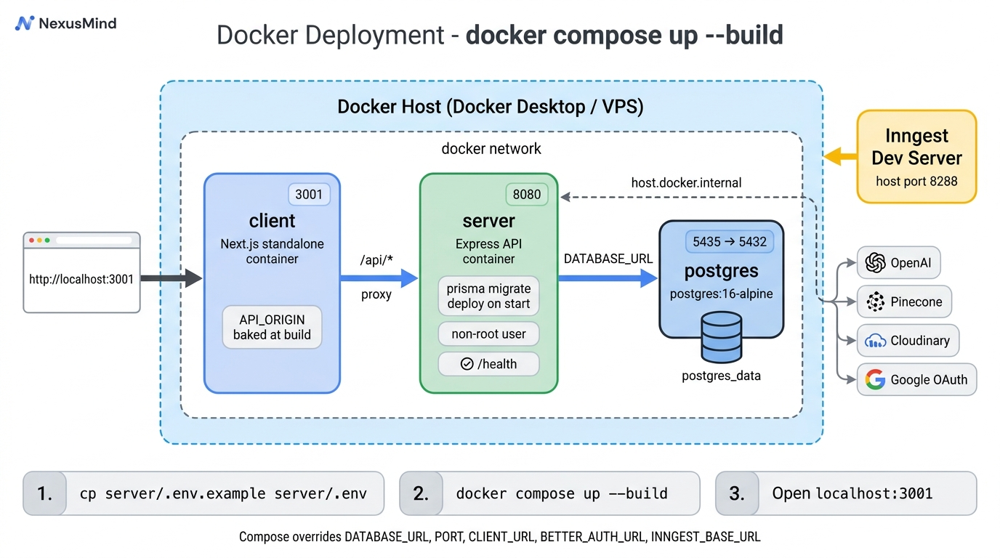

**Vercel setup at a glance:**

| Project | Platform | Notes |
| --- | --- | --- |
| Client | Vercel (Next.js) | `API_ORIGIN` proxies `/api/*` to the backend, so the browser sees a single origin for auth cookies |
| Server | Vercel Serverless Function (`server/api/index.ts`) | 60 s max duration; Inngest is served at `/api/inngest` |
| Jobs | Inngest Cloud | Uses `INNGEST_EVENT_KEY` / `INNGEST_SIGNING_KEY` |
| Data | Managed PostgreSQL, Pinecone, Cloudinary | |

**Docker setup at a glance:** Compose starts `postgres` (5435), `server` (8080) and `client` (3001). Run the Inngest Dev Server on your host (port 8288) for background jobs, because Compose does not include it.

## 10. Detailed Documentation

| Document | Contents |
| --- | --- |
| [Server README](server/README.md) | Backend architecture, API endpoints, data model, background jobs, RAG configuration, environment variables |
| [Client README](client/README.md) | Frontend architecture, routes, feature modules, state and data fetching, environment variables |
| [Deployment Guide](DEPLOY.md) | Docker self-hosting and Vercel deployment, environment variables and post-deploy checklist |

## 11. Next version Roadmap

- [ ] Additional source types (Audio, DOCX, PPTX)
- [ ] Hybrid search (keyword + vector) and re-ranking
- [ ] Workspace sharing and collaboration
- [ ] Artifact export (PDF / Markdown)
- [ ] Usage dashboard and paid quota tiers


