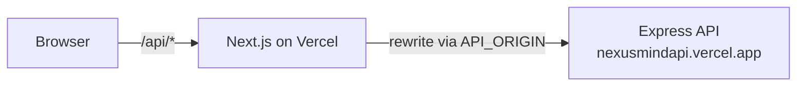

# NexusMind: Frontend

The Next.js 16 (App Router) web client for NexusMind. Users manage workspaces, add sources, chat with their knowledge base using streaming RAG answers, and generate Studio artifacts.

**Production:** https://www.nexusmind.sanjaysorathiya.dev *(custom domain coming soon)*

← [Back to main README](../README.md)

---

## Table of Contents

1. [Tech Stack](#1-tech-stack)
2. [Routes](#2-routes)
3. [Folder Structure](#3-folder-structure)
4. [Feature Modules](#4-feature-modules)
5. [Data Fetching & State](#5-data-fetching--state)
6. [API Communication](#6-api-communication)
7. [Environment Variables](#environment-variables)
8. [Local Setup](#8-local-setup)
9. [Deployment](#9-deployment)

---

## 1. Tech Stack

| Concern | Library |
| --- | --- |
| Framework | Next.js 16 (App Router), React 19, TypeScript |
| Styling | Tailwind CSS 4, shadcn/ui, Base UI, lucide-react |
| Server state | TanStack Query 5 |
| Chat streaming | Vercel AI SDK (`@ai-sdk/react`, `useChat`) |
| Auth | Better Auth client |
| UX | next-themes (light/dark), sonner (toasts), react-resizable-panels |
| Feedback | Web3Forms |

## 2. Routes

| Route | Purpose |
| --- | --- |
| `/` | Landing page, plus the workspace list for signed-in users |
| `/sign-in` | Google sign-in |
| `/workspace/[workspaceId]` | Three-panel workspace: **Sources · Chat · Studio** |

## 3. Folder Structure

```text
client/
├── app/                    # App Router pages & layout
│   ├── page.tsx
│   ├── sign-in/
│   └── workspace/[workspaceId]/
├── components/
│   ├── ui/                 # shadcn/ui primitives
│   ├── nx/                 # Brand shell, landing, logo
│   ├── auth/               # User menu
│   └── providers/          # Query & theme providers
├── features/               # Feature modules (api · hooks · types · components)
│   ├── workspaces/
│   ├── sources/
│   ├── conversations/
│   ├── artifacts/
│   └── chat/
├── hooks/                  # use-require-auth, use-user-quota, ...
├── lib/                    # api client, auth-client, config, query-keys
├── Dockerfile
└── next.config.ts          # /api rewrite + security headers
```

## 4. Feature Modules

Each feature follows the same convention: `api.ts` (fetchers), `hooks.ts` (TanStack Query hooks), `types.ts` and `components/`.

| Feature | Key Components |
| --- | --- |
| `workspaces` | Workspace card, create/edit dialog, delete dialog, empty state |
| `sources` | Sources panel, add-source dialog (PDF · Website · YouTube · Text/Markdown), source detail |
| `conversations` | Chat panel, message list with citations, composer, quota banner |
| `artifacts` | Studio panel, artifact viewer (summary, flashcards, quiz, mind map, report) |

## 5. Data Fetching & State

- All server data goes through **TanStack Query**, with keys centralized in `lib/query-keys.ts`.
- Sources and artifacts are polled while they are `PENDING` / `PROCESSING`, until they reach `READY` or `FAILED`.
- Chat uses the AI SDK `useChat` hook. It streams from `POST /api/workspaces/:id/conversations/messages`.
- `use-require-auth` protects routes. `use-user-quota` shows the remaining token budget.

## 6. API Communication



In production, `next.config.ts` rewrites `/api/*` to the backend. To the browser, the frontend and the API share one origin, so auth cookies work without third-party cookie issues. In local development, the client calls `NEXT_PUBLIC_API_URL` directly.

The app also sends security headers: `X-Frame-Options: DENY`, `nosniff`, a strict referrer policy and a restrictive permissions policy.

## Environment Variables

Copy `.env.example` to `.env.local`.

| Variable | Where | Description |
| --- | --- | --- |
| `NEXT_PUBLIC_API_URL` | Local | Backend URL for development (default `http://localhost:8080`) |
| `API_ORIGIN` | Vercel only | Backend origin used for the server-side `/api` rewrite |
| `NEXT_PUBLIC_WEB3FORMS_KEY` | Optional | Feedback form key |

## 8. Local Setup

```bash
cd client
cp .env.example .env.local
npm install
npm run dev          # http://localhost:3001
```

| Script | Purpose |
| --- | --- |
| `npm run dev` | Dev server on port 3001 |
| `npm run build` | Production build |
| `npm start` | Serve production build |
| `npm run lint` | ESLint |
| `npm run typecheck` | Type-check |
| `npm run format` | Prettier |

## 9. Deployment

- Deployed on **Vercel** as a Next.js project.
- Set `API_ORIGIN=https://nexusmindapi.vercel.app` in the Vercel project settings.
- Add the frontend domain to the backend's `CLIENT_URL`, and to the Google OAuth authorized origins and redirect URIs.
- Full step-by-step Vercel setup and custom domain steps: see the [Deployment Guide](../DEPLOY.md#vercel-deployment).
- Docker: `output: "standalone"` produces a self-contained image (`client/Dockerfile`). The root `docker-compose.yml` builds it with `API_ORIGIN` set to the API container. See the [Docker section](../DEPLOY.md#docker-self-hosting).
