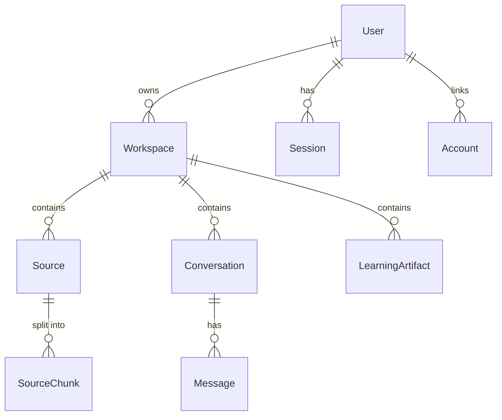

# NexusMind: Backend API

The Express 5 + TypeScript API behind NexusMind. It handles authentication, workspaces, source ingestion, RAG chat streaming, memory and artifact generation. Long-running work runs in durable **Inngest** jobs.

**Production:** https://nexusmindapi.vercel.app · **Health check:** [`/health`](https://nexusmindapi.vercel.app/health)

← [Back to main README](../README.md)

---

## Table of Contents

1. [Architecture](#1-architecture)
2. [Folder Structure](#2-folder-structure)
3. [API Endpoints](#3-api-endpoints)
4. [Data Model](#4-data-model)
5. [Background Jobs](#5-background-jobs)
6. [RAG Configuration](#6-rag-configuration)
7. [Environment Variables](#environment-variables)
8. [Local Setup](#8-local-setup)
9. [Deployment](#9-deployment)

---

## 1. Architecture

Requests pass through a strict layered flow:

```text
Route → requireAuth middleware → Controller (Zod validation) → Service (business logic) → Prisma / External SDKs
                                                                                      ↘ errorHandler middleware
```

| Layer | Responsibility |
| --- | --- |
| `routes/` | Map HTTP verbs and paths to controllers; attach `requireAuth` |
| `controllers/` | Parse and validate input with Zod, call services, shape responses |
| `services/` | Business logic, ownership checks, DB access |
| `lib/` | SDK clients and helpers (OpenAI, Pinecone, Cloudinary, Firecrawl, Tavily, Mem0, chunking, quota, moderation) |
| `inngest/` | Durable background functions |
| `validators/` | Zod schemas per resource |

## 2. Folder Structure

```text
server/
├── api/index.ts            # Vercel serverless entry
├── prisma/
│   ├── schema.prisma       # Data model
│   └── migrations/
├── scripts/                # Maintenance scripts (e.g. verify-quota)
├── src/
│   ├── index.ts            # Express app bootstrap
│   ├── controllers/
│   ├── services/
│   ├── routes/
│   ├── middleware/         # requireAuth, upload (multer), errorHandler
│   ├── validators/
│   ├── inngest/            # client + functions
│   ├── lib/
│   │   ├── rag/retrieve.ts # Vector retrieval
│   │   ├── aiConfig.ts     # RAG / model tuning knobs
│   │   └── ...
│   ├── types/
│   └── utils/
├── Dockerfile
└── vercel.json
```

## 3. API Endpoints

All routes except `/`, `/health`, `/api/auth/*` and `/api/inngest` require an authenticated session cookie.

### System & Auth
| Method | Path | Description |
| --- | --- | --- |
| GET | `/` | API info |
| GET | `/health` | Health check |
| ALL | `/api/auth/*` | Better Auth handlers (Google OAuth, session) |
| ALL | `/api/inngest` | Inngest function endpoint |
| GET | `/api/user/quota` | Current user's token usage and limit |

### Workspaces: `/api/workspaces`
| Method | Path | Description |
| --- | --- | --- |
| GET | `/` | List the user's workspaces |
| POST | `/` | Create a workspace |
| GET | `/:workspaceId` | Get a workspace |
| PATCH | `/:workspaceId` | Update a workspace |
| DELETE | `/:workspaceId` | Delete a workspace and its data |

### Sources: `/api/workspaces/:workspaceId/sources`
| Method | Path | Description |
| --- | --- | --- |
| GET | `/` | List sources |
| POST | `/pdf` | Upload a PDF (multipart) |
| POST | `/website` | Import a website URL |
| POST | `/youtube` | Import a YouTube transcript |
| POST | `/text-markdown` | Add pasted Text or Markdown |
| POST | `/:sourceId/retry` | Retry a failed source |
| POST | `/bulk-delete` | Delete multiple sources |
| GET | `/:sourceId` | Get a source |
| DELETE | `/:sourceId` | Delete a source and its vectors |

### Conversations: `/api/workspaces/:workspaceId/conversations`
| Method | Path | Description |
| --- | --- | --- |
| GET | `/` | List conversations |
| POST | `/` | Create a conversation |
| POST | `/messages` | Send a message and **stream** the RAG answer (AI SDK UI stream) |
| GET | `/:conversationId/messages` | Get message history |
| DELETE | `/:conversationId` | Delete a conversation |

### Artifacts: `/api/workspaces/:workspaceId/artifacts`
| Method | Path | Description |
| --- | --- | --- |
| GET | `/` | List artifacts |
| POST | `/` | Request generation (`SUMMARY`, `TAKEAWAYS`, `FLASHCARDS`, `QUIZ`, `MINDMAP`, `REPORT`) |
| GET | `/:artifactId` | Get an artifact |
| DELETE | `/:artifactId` | Delete an artifact |

### Memories: `/api/memories`
| Method | Path | Description |
| --- | --- | --- |
| GET | `/` | List memories |
| GET | `/search` | Semantic memory search |
| POST | `/` | Create a memory |
| GET | `/:memoryId` | Get a memory |
| PATCH | `/:memoryId` | Update a memory |
| DELETE | `/:memoryId` | Delete a memory |

## 4. Data Model



| Enum | Values |
| --- | --- |
| `SourceType` | `PDF`, `WEBSITE`, `YOUTUBE`, `TEXT`, `MARKDOWN` |
| `SourceStatus` / `ArtifactStatus` | `PENDING`, `PROCESSING`, `READY`, `FAILED` |
| `ArtifactType` | `SUMMARY`, `TAKEAWAYS`, `FLASHCARDS`, `QUIZ`, `MINDMAP`, `REPORT` |
| `MessageRole` | Chat message roles |

## 5. Background Jobs

| Function | Trigger | Purpose |
| --- | --- | --- |
| `process-source` | `source/created` | Extract → chunk → embed → index to Pinecone; marks `READY` / `FAILED` (3 retries) |
| `summarize-conversation` | `conversation/summarize` | Rolling conversation summary (every 8 messages) |
| `generate-artifact` | artifact event | Generates Studio artifacts from workspace sources |
| `reap-stale-sources` | cron | Marks sources and artifacts stuck for more than 5 min as `FAILED` (retryable) |

## 6. RAG Configuration

All tuning settings are in [`src/lib/aiConfig.ts`](src/lib/aiConfig.ts).

| Setting | Value |
| --- | --- |
| Chat models | `gpt-4o-mini` (default), `gpt-4o` |
| Embedding model | `text-embedding-3-small` (1536 dimensions) |
| Chunk size / overlap | 1000 / 100 characters |
| Retrieval top-K | 6 |
| Min similarity score | 0.15 |
| Summary interval | Every 8 messages |
| Recent message window | 12 |
| Pinecone namespace | One per `workspaceId` |

## Environment Variables

Copy `.env.example` to `.env`.

| Variable | Required | Description |
| --- | --- | --- |
| `DATABASE_URL` | ✅ | PostgreSQL connection string |
| `BETTER_AUTH_SECRET` | ✅ | Session signing secret |
| `BETTER_AUTH_URL` | ✅ | Public base URL of the auth server |
| `CLIENT_URL` | ✅ | Frontend origin (CORS and trusted origins) |
| `GOOGLE_CLIENT_ID` | ✅ | Google OAuth client ID |
| `GOOGLE_CLIENT_SECRET` | ✅ | Google OAuth client secret |
| `OPENAI_API_KEY` | ✅ | OpenAI chat, embeddings and moderation |
| `PINECONE_API_KEY` | ✅ | Pinecone API key |
| `PINECONE_INDEX` | ✅ | Pinecone index name (1536-d, cosine) |
| `CLOUDINARY_CLOUD_NAME` | ✅ | Cloudinary account |
| `CLOUDINARY_API_KEY` | ✅ | Cloudinary key |
| `CLOUDINARY_API_SECRET` | ✅ | Cloudinary secret |
| `CLOUDINARY_FOLDER` | ⬜ | PDF upload folder (default `nexusmind/pdfs`) |
| `FIRECRAWL_API_KEY` | ⬜ | Website import |
| `TAVILY_API_KEY` | ⬜ | Web search in chat |
| `MEM0_API_KEY` | ⬜ | Long-term user memory |
| `TOKEN_QUOTA_PER_USER` | ⬜ | Lifetime token budget per user (default 50,000) |
| `INNGEST_DEV` | ⬜ | Set to `1` for local development only |
| `INNGEST_EVENT_KEY` | Prod | Inngest event key |
| `INNGEST_SIGNING_KEY` | Prod | Inngest signing key |
| `INNGEST_SERVE_ORIGIN` | Prod | Public origin Inngest calls back to |
| `PORT` | ⬜ | Local port (default 8080) |

## 8. Local Setup

```bash
cd server
cp .env.example .env
npm install
npx prisma migrate deploy      # or: npx prisma migrate dev
npm run dev                    # http://localhost:8080

# In a separate terminal: Inngest dev server
npx inngest-cli@latest dev -u http://localhost:8080/api/inngest
```

| Script | Purpose |
| --- | --- |
| `npm run dev` | Watch mode (tsx) |
| `npm run build` | `prisma generate` + `tsc` |
| `npm start` | Run compiled `dist/` |
| `npm run typecheck` | Type-check only |

## 9. Deployment

The API is deployed to **Vercel** as a single serverless function (`api/index.ts`). In [`vercel.json`](vercel.json), every path is rewritten to that function, which has a 60 s max duration.

- Set all production env vars in Vercel, and remove `INNGEST_DEV`.
- Point the Inngest app at `https://nexusmindapi.vercel.app/api/inngest`.
- Run `npx prisma migrate deploy` against the production database before releasing schema changes.
- Full step-by-step Vercel setup, Google OAuth and Inngest steps: see the [Deployment Guide](../DEPLOY.md#vercel-deployment).
- Docker: the image is built from `server/Dockerfile`. The root `docker-compose.yml` starts it together with PostgreSQL and the client. See the [Docker section](../DEPLOY.md#docker-self-hosting).
